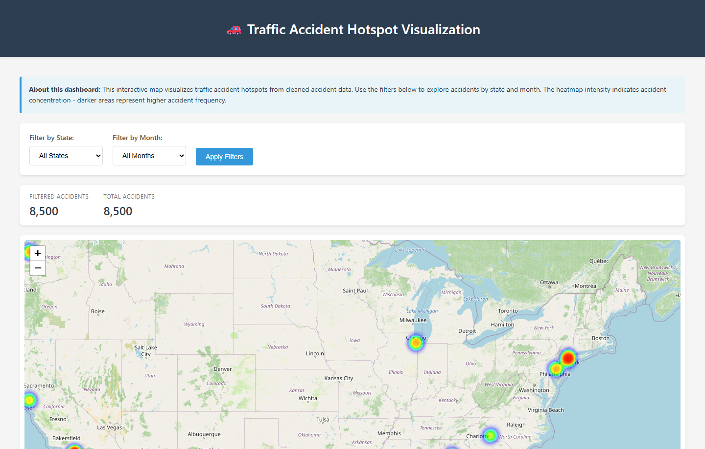
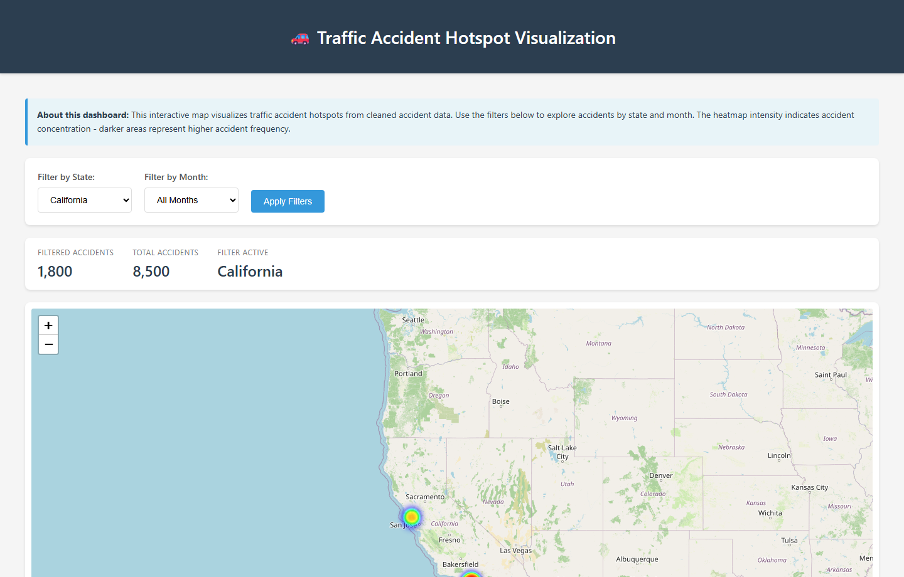
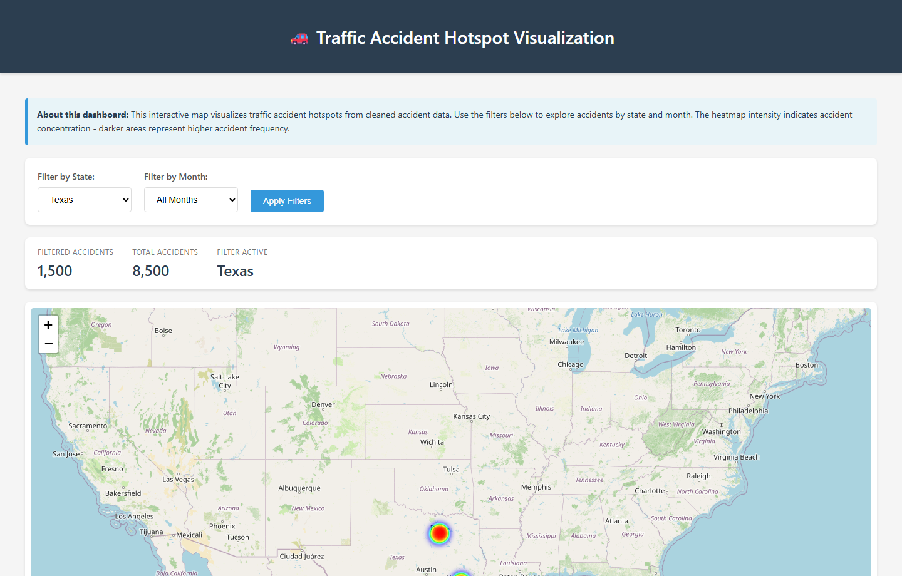
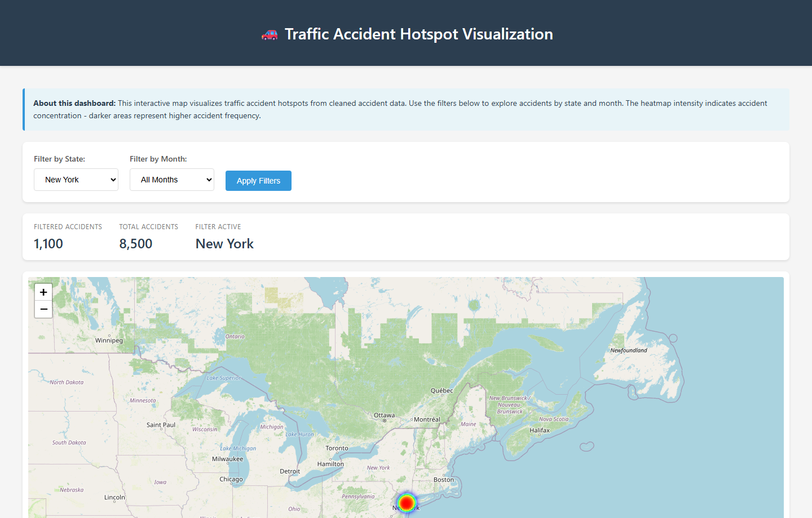
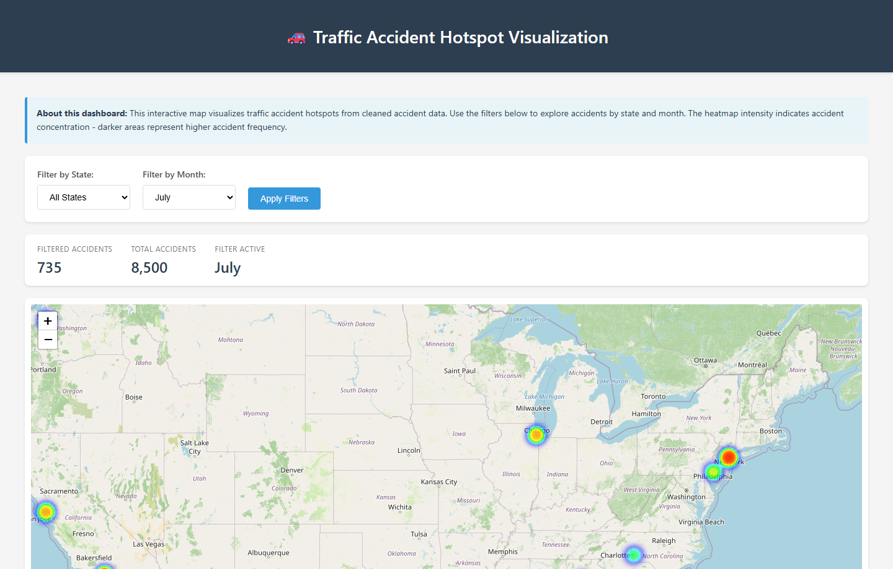

# 🚦 US Traffic Accident Analysis & Hotspot Visualization Dashboard

An end-to-end data engineering and visualization project providing comprehensive exploratory data analysis (EDA), data wrangling, and an interactive Flask web application to visualize nationwide US traffic accident hotspots, state-level risk corridors, and seasonal patterns using Folium heatmaps.

[](https://www.python.org/)
[](https://flask.palletsprojects.com/)
[](https://python-visualization.github.io/folium/)
[](https://pandas.pydata.org/)
[](https://jupyter.org/)

---

## 📸 Interactive Dashboard Previews

### 1. Nationwide Accident Hotspot Overview
Real-time national heatmap plotting accident density across major US metropolitan areas with dynamic statistics counters.


### 2. State-Level Analysis: California (CA)
Filtered view highlighting concentrated high-incident clusters across Greater Los Angeles, the Bay Area, San Diego, and Sacramento corridors.


### 3. State-Level Analysis: Texas (TX)
Hotspot distribution across the Texas Triangle (Houston, Dallas-Fort Worth, Austin, and San Antonio).


### 4. Regional Density: New York Metro (NY)
High-density urban accident clusters centered around the NYC metropolitan zone, Long Island, and major upstate arterials.


### 5. Seasonal Filtering: July (Summer Peak)
Seasonal temporal analysis tracking accident distribution during peak mid-year travel months.


---

## 🌟 Key Features

- **Interactive Folium Heatmaps**: Geospatial hotspot visualization with dynamic clustering, zooming, and panning.
- **Dynamic Multi-Parameter Filters**:
  - **State Filter**: Drill down into individual states (e.g., CA, TX, FL, NY, IL, GA, PA, WA, NC) or view the nationwide aggregate.
  - **Month Filter**: Track accident seasonality across all 12 calendar months.
- **Data Wrangling Pipeline**: Comprehensive Jupyter notebook covering missing value imputation, spatial coordinate verification, date-time parsing, and feature engineering.
- **Intelligent Spatial Sampling**: Auto-sampled rendering (up to 10,000 points) ensuring responsive, smooth 60fps browser interactions.
- **Lightweight Architecture**: Modular Flask backend with zero heavy database overhead.

---

## 📂 Project Structure

```
accident-analysis/
│
├── app.py                      # Flask web application & Folium map engine
├── notebooks/
│   └── Traffic_Accident_Data_Wrangling.ipynb  # Comprehensive data wrangling & EDA
├── data/
│   └── cleaned_accidents.csv   # Cleaned geospatial accident dataset
├── screenshots/                # Visual documentation & dashboard previews
│   ├── 01_overview_heatmap.png
│   ├── 02_california_hotspots.png
│   ├── 03_texas_hotspots.png
│   ├── 04_new_york_hotspots.png
│   └── 05_seasonal_filter_july.png
├── templates/
│   └── index.html             # Dashboard UI with responsive filters and metrics
├── static/                     # Custom assets and styles
├── requirements.txt            # Python dependencies
└── README.md                   # Project documentation
```

---

## 🛠️ Prerequisites & Installation

### 1. Clone the Repository
```bash
git clone https://github.com/suneharati08/accident-analysis.git
cd accident-analysis
```

### 2. Install Dependencies
```bash
pip install -r requirements.txt
```

### 3. Verify Dataset
Ensure `cleaned_accidents.csv` is present in the `data/` directory with the following columns:
- `Start_Lat`: Latitude of accident location (float)
- `Start_Lng`: Longitude of accident location (float)
- `State`: 2-letter US State abbreviation (e.g., `CA`, `TX`, `NY`)
- `Month`: Numeric month `1` - `12` (integer)
- `Severity`: Accident severity scale (integer)

---

## 🚀 Running the Project

### Running the Interactive Web Dashboard
1. Start the Flask application:
```bash
python app.py
```
2. Navigate to:
```
http://127.0.0.1:5000
```
3. Use the dropdown filters to inspect specific states or months and view updated accident counts in real time.

### Running the Data Wrangling Notebook
Launch Jupyter to explore the step-by-step data engineering process:
```bash
jupyter notebook notebooks/Traffic_Accident_Data_Wrangling.ipynb
```

---

## ⚙️ Technical Architecture

| Component | Technology | Purpose |
|---|---|---|
| **Web Framework** | Flask | Routing, parameter processing, template rendering |
| **Geospatial Engine** | Folium / Leaflet.js | Heatmap generation, interactive tiles, point clustering |
| **Data Analysis** | Pandas & NumPy | High-performance filtering, aggregation, coordinate math |
| **EDA & Modeling** | Jupyter, Matplotlib, Seaborn | Exploratory analysis, distribution plotting, wrangling |
| **Frontend** | HTML5, CSS3, Jinja2 | Responsive layout, modern filter bar, metrics counter cards |

---

## 📝 License
This project is developed for educational and data visualization demonstration purposes.
